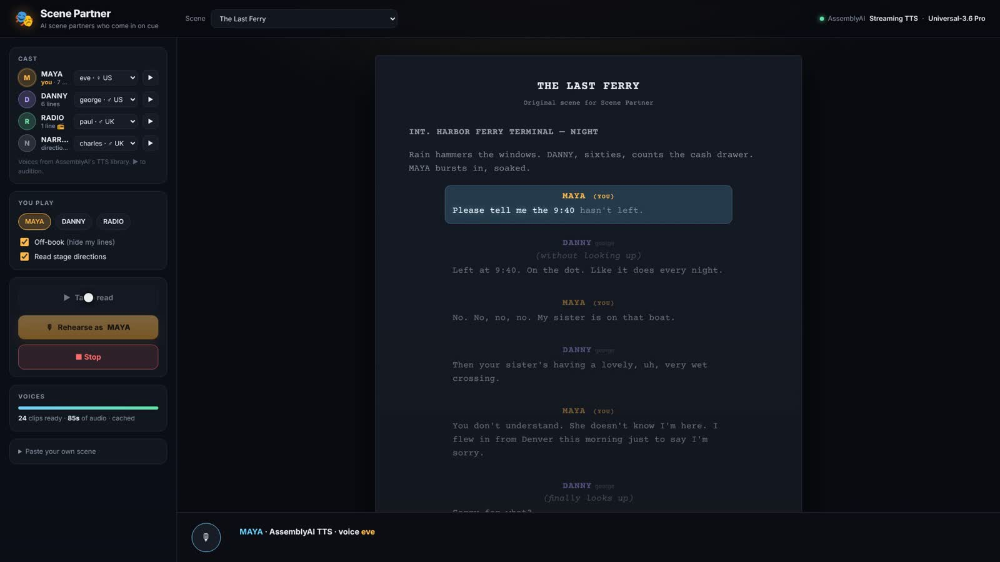
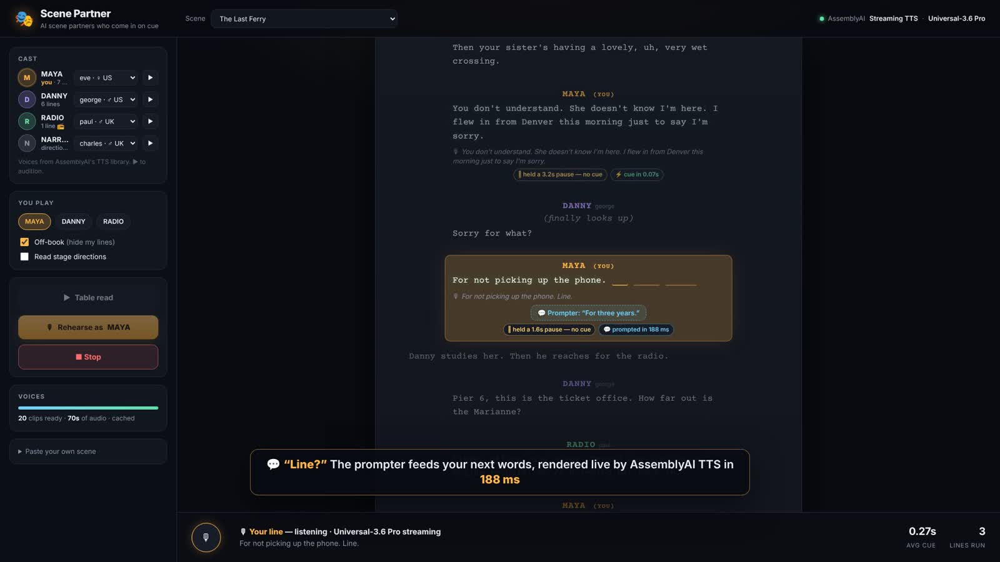
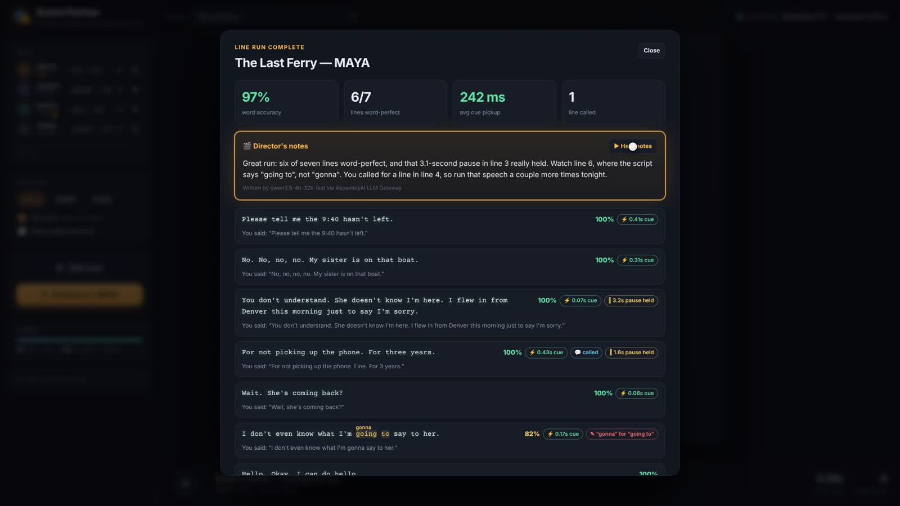
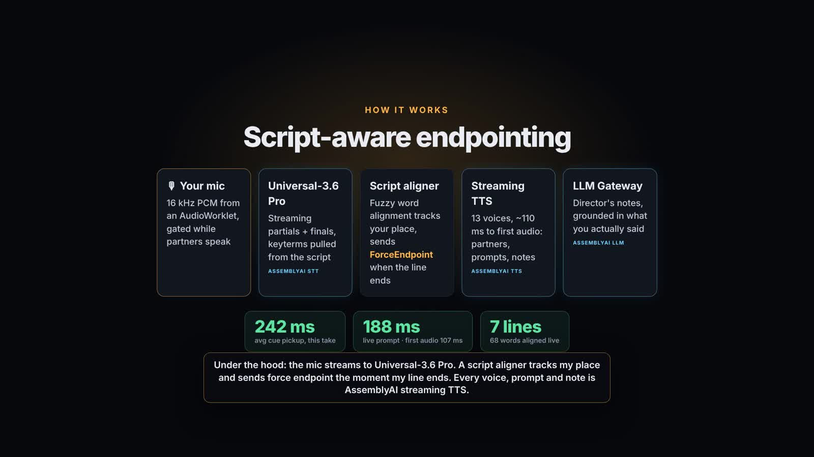

# 🎭 Scene Partner

**Rehearse any scene with AI scene partners who come in on cue.**

Paste a scene, pick your role, and run your lines out loud. Every other character is voiced with
**AssemblyAI's streaming TTS**, and **Universal-3.6 Pro** streaming speech-to-text follows you through
the script, so your partner comes in the moment *your line* is finished. A dramatic pause doesn't
trigger the cue. Say "Line?" and a prompter feeds you the next words. When you're done, you get a
report card and notes from your director.

Built for the AssemblyAI *Voice hackathon week: Hack into speech* (Oct 2026).

▶️ **Demo video:** [`demo/scene-partner-demo.mp4`](demo/scene-partner-demo.mp4) (3:05, 1080p). Every voice in it,
including the narration, is AssemblyAI TTS.

| Table read | Rehearsal |
| --- | --- |
|  |  |
| **Report card** | **How it works** |
|  |  |

## What it does

- **Table read.** Every character gets a voice from AssemblyAI's TTS library (13 English voices,
  auto-cast by gender/accent, changeable per character). Lines are rendered over the streaming TTS
  WebSocket, and words light up in time using the TTS word boundaries. A narrator voice reads scene
  headings and stage directions. The `RADIO` character gets a walkie-talkie effect in Web Audio.
- **Rehearse, off-book.** Your lines are hidden; words reveal themselves as Universal-3.6 Pro hears
  them. Fumbled words turn amber, skipped ones red.
- **Script-aware endpointing.** Scene Partner knows what you're supposed to say. It aligns the live
  transcript against your line, and once you go quiet near the end of it, it sends `ForceEndpoint`
  so the partner is cued immediately (about 240 ms on average in the demo take). A mid-line pause is
  held, not cued, because the line isn't finished.
- **"Line?"** Call for a line and the prompter (narrator voice) speaks your next few words, rendered
  live by the TTS in about 200 ms.
- **Report card.** You get word accuracy, lines word-perfect, cue pickup per line, held pauses,
  paraphrases ("gonna" for "going to"), and director's notes. The notes are drafted from the scored
  run and phrased by AssemblyAI's LLM Gateway. A check rejects any rewrite that invents quotes or
  numbers. The notes are then read back with TTS.
- **Any script.** `NAME: line`, screenplay format (cue on its own line, `(parentheticals)`) and
  stage-play format (`LADY BRACKNELL.` + `[directions]`, as on Project Gutenberg) all parse. Two
  scenes are included: an original, *The Last Ferry*, and the hand-bag scene from *The Importance of
  Being Earnest* (public domain).

## Quick start

Requires Node 18+ and an AssemblyAI API key with access to the streaming TTS endpoint.

```bash
cp .env.example .env        # add ASSEMBLYAI_API_KEY
npm install
npm start                   # http://localhost:3000
```

Open it in Chrome or Edge, and **use headphones** for rehearsals. The mic is gated while partners
speak, but headphones keep their voices out of your transcript entirely. Press **Space** to force
"I'm done with my line" and **Esc** to stop.

## How it uses AssemblyAI

| Piece | Where | How |
| --- | --- | --- |
| **Streaming TTS** `wss://streaming-tts.assemblyai.com/v1/ws` | `server/tts.mjs` | Partner lines, narrator, live prompts, spoken notes. Disk-cached per voice and text. |
| **Universal-3.6 Pro** `wss://streaming.assemblyai.com/v3/ws` | `server/stt-relay.mjs`, `public/app.js` | Streams 16 kHz PCM from an AudioWorklet through a local relay (the key stays on the server). Uses partials for live alignment, finals for scoring, `keyterms_prompt` from the script's proper nouns, and `ForceEndpoint` for script-aware turn ends. |
| **LLM Gateway** `qwen3.5-4b-32k-fast` | `server/llm.mjs` | Rewrites rule-drafted director's notes; a faithfulness check falls back to the draft. |
| **Pre-recorded STT** (Universal-3.5 Pro) | `scripts/qa-clips.mjs` | "TTS proofreading": transcribes every rendered clip and scores it against its text. |

### Streaming TTS protocol notes

These were learned against the live endpoint during the hackathon, since there were no public docs yet:

- Connect with `?voice=&language=&sample_rate=&encoding=` and an `Authorization` header. The server sends
  `Begin {configuration}`.
- Send `{"type":"Generate","text":…}` then `{"type":"Flush"}`. You receive base64 PCM in `Audio`
  messages, then `FlushDone {audio_duration_ms}` and `WordBoundaries {audio_start_ms, words}`. Other
  message types: `KeepAlive`, `Cancel`, `Terminate`, `VoiceReference` (cloning is not enabled).
- **Word timings are cumulative per session.** Subtract `audio_start_ms` to get clip-relative times.
- Voice is fixed per connection: 13 English voices, plus one each for French, German, Italian,
  Portuguese and Spanish. Sample rates are 8–48 kHz; encodings are `pcm_s16le`, `pcm_mulaw` and `pcm_alaw`.
- First audio arrives in about 110 ms.
- The account allows **4 concurrent sessions**, and a closed session keeps counting against that for
  about a minute. Scene Partner keeps one warm session per voice (with `KeepAlive`) instead of reopening.
- One phrasing to avoid: `"uh..."` (a filler followed by an ellipsis) consistently ended synthesis early in
  testing. `"uh,"` works. `scripts/qa-clips.mjs` caught this.

## Demo mode and the video

`http://localhost:3000/?demo=1` replaces the microphone with a **simulated actor**. A stand-in TTS voice
speaks your lines, including a deliberate mid-line pause, a "Line?" call and a "gonna", into the same
mic bus a real microphone uses. It goes through the same relay, Universal-3.6 Pro stream and aligner;
the cues are not faked. The performance is defined in `scenes/01-last-ferry.demo.json`.

```bash
npm start                                   # in one shell
node scripts/e2e-demo.mjs                   # full rehearsal in headless Chromium, prints the report
node scripts/record-demo.mjs demo/build     # records a take (screencast + in-page audio)
node scripts/build-video.mjs demo/build/take-…   # → scene-partner-demo.mp4
node scripts/qa-clips.mjs [--fix]           # proofread rendered clips with STT
npm test                                    # parser + aligner unit tests
```

## Project layout

```
server/      index.mjs (HTTP + API), tts.mjs (TTS client, session pool, cache),
             stt-relay.mjs, llm.mjs (director's notes), env.mjs
public/      index.html, styles.css, app.js
public/lib/  parse.js (script parser), align.js (normalize + align + score),
             audio.js (playback, FX, mic bus, recorder), stt.js, demo.js
public/worklets/  capture.js (→16 kHz PCM16), recorder.js
scenes/      *.txt scenes, *.demo.json stand-in performances
scripts/     e2e-demo, record-demo, build-video, qa-clips, voices
test/        node:test unit tests
```

## Credits

*The Last Ferry* is an original scene written for this project. *The Importance of Being Earnest* (Oscar Wilde,
1895) is public domain, via Project Gutenberg #844. Fonts: Inter and Courier Prime (Google Fonts).
